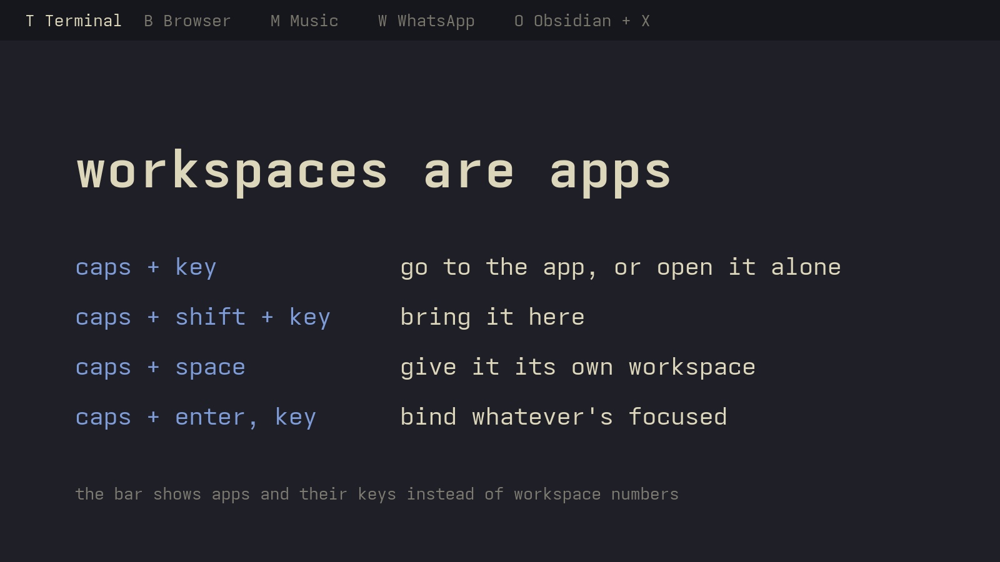

# appkeys

**Workspaces are apps.** Hold caps and press a key to go to an app. If it isn't
running, it opens alone on a fresh workspace. Workspace numbers stop mattering,
so the bar widget swaps them for the apps on each workspace and their keys.



| chord | does |
|---|---|
| `caps + key` | go to the app. Press again to cycle its windows. Not running: launch it on an empty workspace |
| `caps + shift + key` | bring it here: pull its window into this workspace (tiled), or launch it here |
| `caps + space` | send the focused window off to its own empty workspace |
| `caps + enter`, then `key` | bind the focused app to `caps + key`, after a confirm. `backspace` instead unbinds it, `esc` cancels |
| tap `caps` | escape |

A window alone on a workspace gets no gaps and no border, so it fills the screen.

Starts with common apps on their first letter (b browser, t terminal, f files, c Claude, g ChatGPT, s Slack, w WhatsApp, y YouTube, ...; see `keys.default.tsv`). Bind anything else with `caps + enter`.

Keys: `0-9`, `a-z` except `h j k l` (caps + those stay arrows), and
`- = [ ] ; ' # , . / \` by physical key, labelled as on a UK keyboard. Grave
is left out.

## Requirements

- Omarchy 4 (Quattro) / Hyprland 0.55+ with the Lua config
- [keyd](https://github.com/rvaiya/keyd) with Omarchy's caps-as-hyper layer
  (`capslock = overload(hyper, esc)` + `[hyper:C-A-M-S]`), or your own caps setup
- `python3` (stdlib only), `notify-send`, `hyprctl`
- Optional, with fallbacks: `omarchy-launch-webapp`, `omarchy-menu-select`,
  `omarchy-launch-terminal-herdr`

## Install

The bar widget is an ordinary plugin. The keys need a Hyprland module and a
keyd tweak, which `install.sh` sets up. Omarchy's plugin installer never runs
plugin code, so that step is yours to run.

```bash
omarchy plugin add https://github.com/jamesd7788/appkeys.git
~/.config/omarchy/plugins/io.github.jamesd7788.appkeys/install.sh
omarchy plugin enable io.github.jamesd7788.appkeys
omarchy plugin disable omarchy.workspaces     # optional: drop the numbers
```

`install.sh` lists what it will change and asks before doing anything
(`--yes` skips the question, `--no-keyd` leaves keyd alone). It:

1. links `~/.local/bin/appkeys` and `~/.config/hypr/appkeys.lua` into the plugin
   checkout, so `omarchy plugin update` updates everything
2. appends a marked `-- >>> appkeys >>>` block to `~/.config/hypr/bindings.lua`
   (after backing it up) that `pcall`s the module. If a Hyprland update ever
   breaks it you get a notification, not a broken config
3. creates `~/.config/appkeys/keys.tsv` from `keys.default.tsv` if missing
4. **as root (sudo):** backs up `/etc/keyd/default.conf`, changes `[hyper:C-A-M-S]`
   to `[hyper:G]` and runs `keyd reload`. Held caps then sends AltGr. The module
   appends `lv3:ralt_switch` to your existing `kb_options`, which makes that Mod5.
   Nothing else uses Mod5, so shift and ctrl stack on caps cleanly. This is the
   only privileged step

Re-run it after `omarchy refresh hyprland`, which rewrites `bindings.lua`. Normal
`omarchy update` doesn't touch anything appkeys changed.

## Remove

```bash
~/.config/omarchy/plugins/io.github.jamesd7788.appkeys/uninstall.sh
omarchy plugin remove io.github.jamesd7788.appkeys
omarchy plugin enable omarchy.workspaces
```

`uninstall.sh` asks first. It removes the bindings block and links, and puts
keyd back to `[hyper:C-A-M-S]` (as root, after a backup). Your key table in
`~/.config/appkeys/` is left alone.

## The key table

`~/.config/appkeys/keys.tsv`: `key  name  kind  target  [launch]`

| kind | target | matches |
|---|---|---|
| `web` | URL | chromium `--app` window for it (any profile) |
| `pwa` | chromium app id | installed PWA (launched via its desktop entry) |
| `class` | window class, alternatives split by `\|` | that class |
| `proc` | process name | terminal window whose direct child is it (TUIs, herdr) |
| `cmd` | command | nothing, it just runs |

`caps + enter` writes it for you. It works out the kind from the focused window:
chromium app → web/pwa, terminal → the program inside it, otherwise the desktop
entry, otherwise the process command line. The confirm shows the launch command,
so you can spot a bad guess. `appkeys list` prints the table and
`appkeys describe` shows what a bind would produce for the focused window.

## Bar widget settings

- **Labels:** key and name (default), name only, or key only
- **Longest app name:** where names get cut short

Floating windows are left out of a workspace's label unless they're all it has.
Hover a button for every app on that workspace.

## Notes

- Launch-to-empty switches to an empty workspace *then* launches. Single-instance
  apps (chromium web apps, slack, telegram) open their window from another
  process, so Hyprland's exec rules can't place them. If you switch away during
  a slow launch, the window lands where you are.
- Windows on special (scratchpad) workspaces are ignored.
- Plugins run unsandboxed with your user permissions. Read `install.sh` and
  `hypr/appkeys.lua` before running them.

## License

MIT
